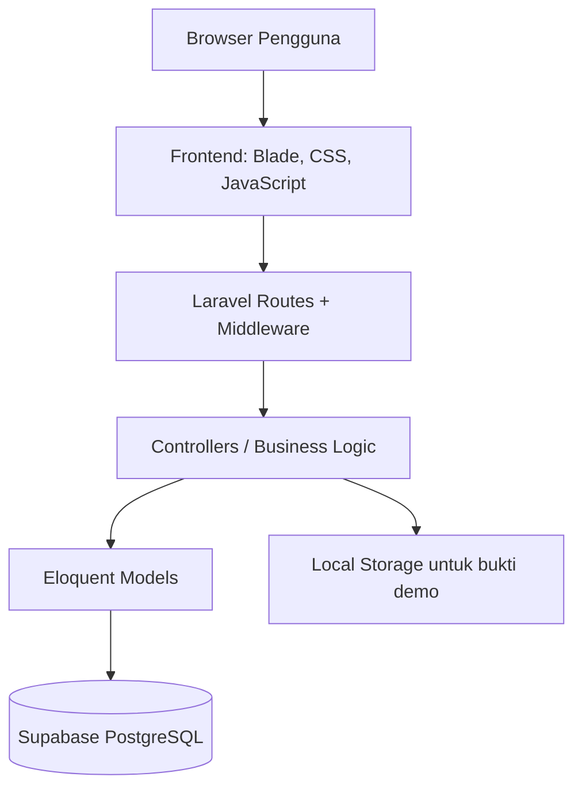
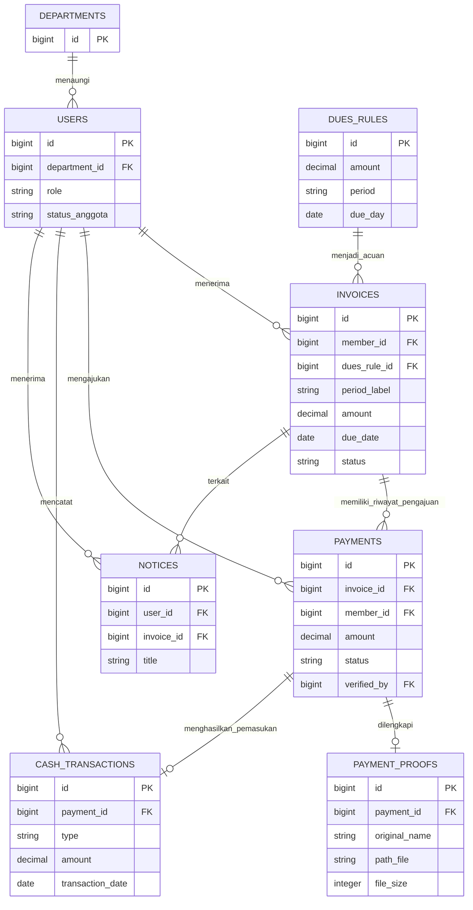
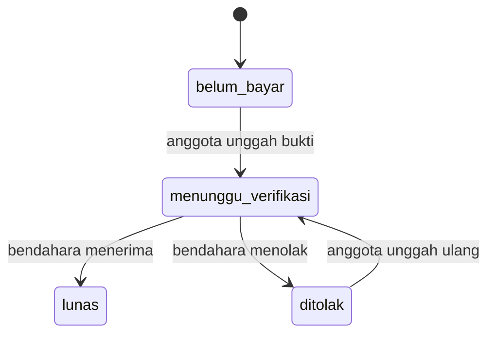

# Arsitektur dan Model Data

## Arsitektur aplikasi

## Pemetaan entitas terhadap dokumen Modul 2

| Entitas dokumen | Implementasi | Keterangan |
|---|---|---|
| Departemen | `departments` | Master departemen anggota |
| AnggotaBEM | `users` | Data anggota + kredensial + role + status anggota |
| AturanIuran | `dues_rules` | Nominal, frekuensi, tanggal jatuh tempo, aktif/nonaktif |
| Tagihan | `invoices` | Tagihan per anggota dan periode |
| TransaksiKas | `payments` + `cash_transactions` | Pengajuan pembayaran dan buku kas masuk/keluar |
| BuktiPembayaran | `payment_proofs` | Metadata file bukti yang terpisah dari transaksi |

## ERD implementasi

`payments` dapat memiliki lebih dari satu pengajuan untuk satu tagihan karena anggota perlu dapat mengunggah ulang setelah penolakan. Hanya pembayaran yang diterima menghasilkan satu baris pemasukan; kolom `cash_transactions.payment_id` memiliki unique constraint.

## Status pembayaran

